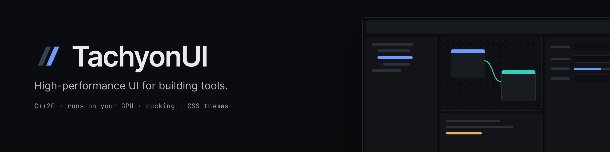
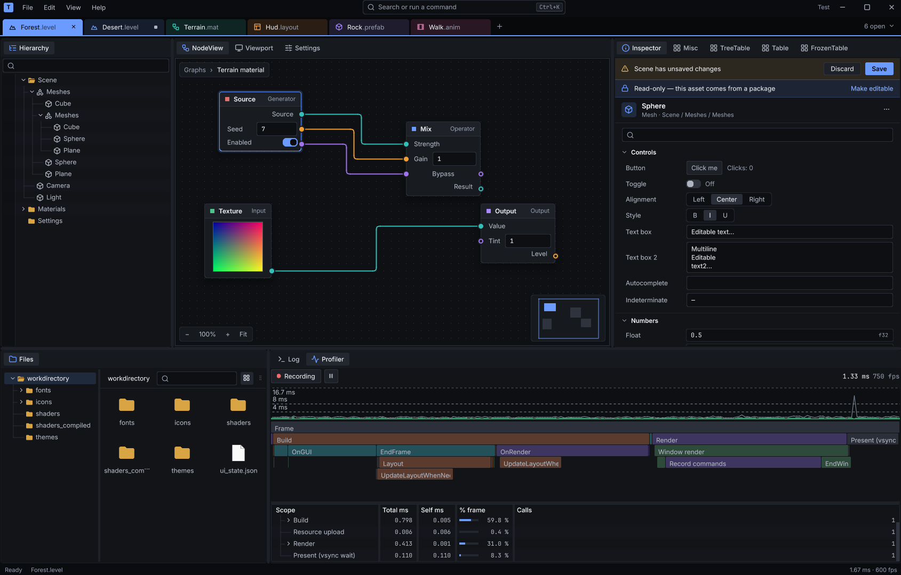

<p align="center">
  
</p>

<p align="center">
  An immediate-mode <b>C++20</b> GUI library for editors and tools,<br>
  with docking, the controls tools need and CSS themes, running on your <b>GPU</b>.
</p>

<p align="center">
  <a href="https://github.com/LogicalError/TachyonUI/actions/workflows/ci.yml"></a>
  <a href="https://logicalerror.github.io/TachyonUI/"></a>
  
  
  
  <a href="LICENSE"></a>
</p>

<p align="center">
  <a href="docs/README.md"><b>Guides</b></a> |
  <a href="https://logicalerror.github.io/TachyonUI/"><b>API reference</b></a> |
  <a href="https://github.com/LogicalError/TachyonUI/wiki"><b>Wiki</b></a> |
  <a href="examples/"><b>Examples</b></a> |
  <a href="CHANGELOG.md"><b>Changelog</b></a>
</p>



TachyonUI is for building tools: game and level editors, audio editors, image and 3D tools.
It opens its own windows out of the box, and can also be embedded in an application that
already has a Vulkan renderer.

## Features

| **Docking and windows** | **Controls** | **CSS themes** |
| --- | --- | --- |
| Dock, tab and tear off panels into OS windows. Menus, tooltips, drag and drop. | Fields, sliders, color and gradient editors, tables, trees, list and grid views, node graphs. | Dark and light palettes, UI and font scaling, your own stylesheets, reloaded while the app runs. |
| **Layout** | **Text** | **Standalone or embedded** |
| Flexbox and grid, in CSS pixels scaled by the UI scale. | Shaping, bidi and font fallback for most scripts. | Its own windows by default, or inside your Vulkan renderer. |

## Requirements

### Windows

- Windows x64
- Visual Studio 2026 with CMake 4.2 or newer, or Visual Studio 2022 with CMake 3.22 or newer
- The [Vulkan SDK](https://vulkan.lunarg.com/)
- Git with [Git LFS](https://git-lfs.com/) (the fonts are stored in LFS)

### Linux

- Linux x64
- GCC 13 or newer, or Clang 17 or newer
- CMake 3.22 or newer and Ninja
- The X11 and Wayland development packages SDL3 needs ([list for Ubuntu](.github/linux-packages.txt))
- The [Vulkan SDK](https://vulkan.lunarg.com/), or your distribution's Vulkan and glslang packages
- Git with [Git LFS](https://git-lfs.com/) (the fonts are stored in LFS)

### macOS

Not tested on a Mac yet (help would be appreciated!). CI builds it and runs the tests that need no GPU.

- Apple Clang
- CMake 3.22 or newer and Ninja
- The [Vulkan SDK](https://vulkan.lunarg.com/), or Homebrew's `vulkan-headers`, `vulkan-loader`, `molten-vk` and `glslang`
- Git with [Git LFS](https://git-lfs.com/) (the fonts are stored in LFS)

### To run

- A GPU driver with Vulkan 1.3 and the features listed by
  `VulkanDeviceContext::GetDeviceRequirements()`

## Quick start

```sh
git clone --recursive https://github.com/LogicalError/TachyonUI.git
cd TachyonUI
```

| | Build | Run (from any folder) |
| --- | --- | --- |
| Windows | `build.bat` | `bin\Debug\showcase.exe` |
| Linux and macOS | `./build.sh` | `bin/Debug/showcase` |

`build.bat Release` (or `./build.sh Release`) builds the Release configuration into `bin/Release`.
The scripts use the presets in `CMakePresets.json`, which Visual Studio, VS Code and CLion
also pick up.

The CMake options and how to run the tests are on the wiki:
[Building](https://github.com/LogicalError/TachyonUI/wiki/Building) and
[Running the showcase and tests](https://github.com/LogicalError/TachyonUI/wiki/Running-the-showcase-and-tests).

## Hello world

You describe the whole UI every frame, and the library keeps the state.

```cpp
void OnGUI() override
{
    if (BeginWindow(windowID, "Hello", LayoutOverride{}.Size(360, 160)))
    {
        Label("Name");  Field(name);
        Button("Greet", [this] { greeting = "Hello, " + name + "!"; });
        Text(greeting);
    }
    EndWindow();   // always, whatever BeginWindow returned
}
```

The full program is [examples/hello_world/hello_world.cpp](examples/hello_world/hello_world.cpp).
The frame model, IDs and the Begin/End rules are in [docs/overview.md](docs/overview.md).

## Examples

Each example is a folder in [`examples/`](examples), and [docs/examples.md](docs/examples.md)
walks through them.

| Example | Shows |
| --- | --- |
| `hello_world` | A window with a text field and buttons |
| `controls` | The common controls, as label/value rows |
| `docking` | Panels in a dock layout |
| `custom_theme` | Your own CSS, dark and light palettes, font scaling |
| `host_device` | Running on your Vulkan device and showing an image it renders |
| `showcase` | An editor-style app with most of the library in its panels (the screenshot above) |
| `tutorial` | The [tutorial](docs/tutorial.md)'s app: two docked panels, with buttons and fields |

## Use it in your project

If you're new to TachyonUI, the [tutorial](docs/tutorial.md) goes from an empty folder to an
app with docked panels, buttons and fields.

```cmake
find_package(TachyonUI 0.1 CONFIG REQUIRED)       # after cmake --install
# or: add_subdirectory(external/TachyonUI)
target_link_libraries(my_app PRIVATE TachyonUI::gui_controls)
```

The shaders, default themes and fonts are built into the library and SDL is linked
statically, so there are no extra files or DLLs to ship. Packaging, subprojects, your own
themes and system libraries are covered in [docs/integration.md](docs/integration.md).

## Embedding in your own renderer

This part is optional: by default the library creates its own device and windows. If your
application already renders with Vulkan, TachyonUI can work with it:

- **Share your Vulkan device.** One instance, device and queue; the GUI only destroys what it created.
- **Show an image you render**, such as a 3D viewport, as a control.
- **Render the UI into an image** instead of an OS window, and pass it the input yourself.

The synchronization rules and code are in [Using your own Vulkan device](docs/integration/vulkan-device.md).

## Status

**0.1 preview.** The API will still change. Windows x64 and Linux x64 are built and tested in
CI; macOS is built in CI but hasn't run on a Mac.

---

[Contributing](CONTRIBUTING.md) | [Security](SECURITY.md) |
[Sponsor on GitHub](https://github.com/sponsors/LogicalError) | [Patreon](https://www.patreon.com/c/logicalerror)

MIT licensed. Bundled third-party code, fonts and icons keep their own licenses, listed in
[THIRD_PARTY_NOTICES.txt](THIRD_PARTY_NOTICES.txt).
